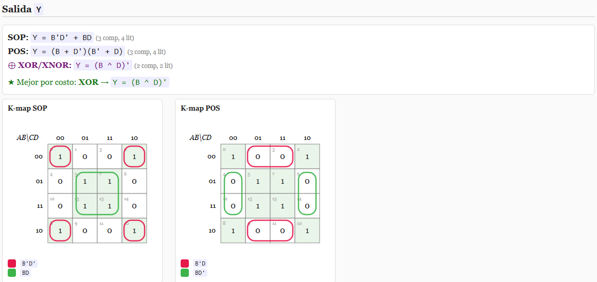
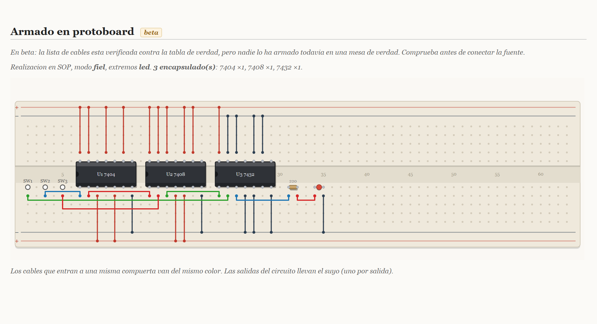
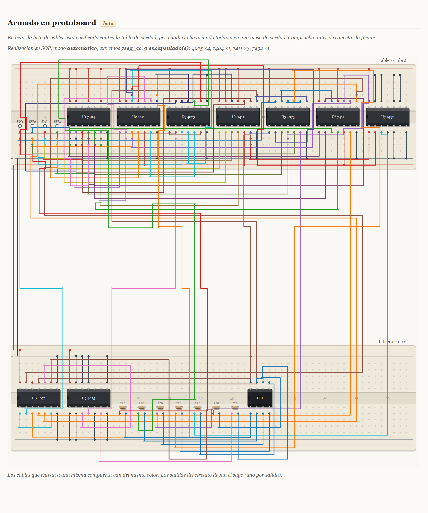

<p align="center">
  <a href="README.md">English</a> · <b>Español</b>
</p>

<div align="center">


# KTool

### Lógica digital, minimizada exacto — y te dice cuándo el XOR sale más barato.

Llenas una tabla de verdad (a mano, desde una expresión o desde una lista de
minterminos) y te devuelve el mapa de Karnaugh, las ecuaciones mínimas en SOP
**y** POS, el diagrama de compuertas, y un documento HTML con todo junto.

[](LICENSE)
[](https://www.python.org/)
[](../../actions/workflows/ci.yml)
[](../../releases/latest)


<br>



</div>

---

Esa imagen es un reporte de verdad, no una maqueta — y enseña justo lo que esta
herramienta hace y un K-map a mano no. Para esa función, el SOP cuesta 3
compuertas y el POS cuesta 3, pero la función es la paridad de B y D, así que
**`(B ^ D)'` cuesta 2**. KTool revisa ese tercer camino siempre y te avisa cuando
gana.

## Qué es

Una herramienta con **dos caras**: una **interfaz por línea de comandos** para
cuando ya tienes los minterminos y quieres la respuesta en la terminal, y una
**interfaz gráfica** que se porta como una hoja de cálculo para cuando estás
llenando la tabla a mano. Las dos producen el mismo documento HTML autocontenido.

Se escribió para la materia de sistemas digitales, y se le nota: trabaja con
varias salidas a la vez, cuenta el costo de lo que propone, y señala los términos
que dos salidas podrían compartir, porque eso es lo que de verdad pregunta una
tarea.

## Propósito y alcance

**El propósito.** Estar en lo correcto, y enseñar el procedimiento. Minimizar a
ojo sobre un mapa de Karnaugh es donde se pierden los puntos — un grupo que no
viste, un *don't care* desperdiciado, un POS que habría salido más barato. Esto
hace la parte mecánica exacta, y luego te entrega un documento que puedes leer y
revisar.

**Qué abarca.** Hasta **6 variables** y **10 salidas** en la misma tabla.
Minimización Quine-McCluskey con *don't cares*, SOP y POS lado a lado con su
costo, XOR/XNOR como tercer candidato, detección de términos compartidos entre
salidas, mapas de Karnaugh a color, diagramas de compuertas, y exportación a
siete lenguajes.

**Qué no es.** Un proyecto de práctica, no una herramienta de diseño
profesional. Las cuentas son exactas —tabla de verdad más Quine-McCluskey— pero
confirma la salida antes de construir algo encima.

## Contenido

- [Qué es](#qué-es) · [Propósito y alcance](#propósito-y-alcance)
- [Instalación](#instalación)
- [Cómo se empieza (CLI)](#cómo-se-empieza-cli) · [Sintaxis de expresiones](#sintaxis-de-expresiones)
- [Cómo se usa (GUI)](#cómo-se-usa-gui)
- [Qué sale](#qué-sale) · [Armado en protoboard](#armado-en-protoboard-beta) *(beta)*
- [Kit de hardware](#kit-de-hardware) — el mismo circuito para PIC, ESP32, Arduino, FPGA, GAL y 74LS
- [Limitaciones conocidas](#limitaciones-conocidas)
- [Para quien quiera meter mano](#contribuir)

> **El comando se llama `ktool`.** `kmap` es un alias histórico —el proyecto nació
> haciendo sólo mapas de Karnaugh— y sigue funcionando igual.

## Instalación

**A — Instalador de Windows (lo más fácil).** Baja el más reciente de
[Releases](../../releases/latest) y córrelo; deja `ktool` en el `PATH`. O en una
línea de PowerShell:

```powershell
irm https://raw.githubusercontent.com/leostriker111/KTool/main/get-ktool.ps1 | iex
```

**B — pip**, si ya tienes Python:

```powershell
pip install git+https://github.com/leostriker111/KTool.git
python -m ktool -h      # funciona siempre, quede o no ktool en el PATH
```

Si después `ktool` solo dice *«no se reconoce»*, pip lo dejó en una carpeta que
no está en tu `PATH` (lo avisa con un `WARNING`). Pasa con el Python de la
Microsoft Store, y cuando pip se va a una instalación «de usuario». Esto
encuentra la carpeta y la agrega, sin tocar el resto de tu `PATH`; luego abre una
terminal nueva:

```powershell
python -m ktool --agregar-al-path
```

**C — desde el código:**

```powershell
git clone https://github.com/leostriker111/KTool.git
cd KTool
powershell -ExecutionPolicy Bypass -File packaging\install.ps1
```

`-ExecutionPolicy Bypass` hace falta porque Windows trae los scripts
deshabilitados. Vale solo para esa corrida; tu configuración se queda igual.

Sin instalar nada, desde la carpeta del proyecto: `python -m ktool ...`

## Cómo se empieza (CLI)

```powershell
ktool -e "A'B + C" --open                 # armar la tabla desde una expresion
ktool -n 3 -m 1,4,5,6 -d 2,7              # minterminos y don't cares
ktool -n 4 -m 0x1,0b11,5 --text           # mezcla de bases, ecuaciones en consola
ktool -n 3 --truth 01x011x1 --form both   # vector de salida directo
ktool ... --gates-only                    # solo compuertas, sin K-map ni tabla
ktool gui                                 # abrir la ventana
ktool -h                                  # ayuda completa
```

| switch | para qué sirve |
|---|---|
| `-n, --vars N` | Número de variables (2 a 6). |
| `-e, --expr "..."` | Expresión booleana; arma la tabla evaluando todos los casos. |
| `-m, --minterms ...` | Minterminos en decimal, `0x` hex o `0b` binario. |
| `-d, --dontcares ...` | *Don't cares*, misma sintaxis. |
| `--truth 01x10...` | Vector de salida directo (largo `2^n`, admite `x`). |
| `--name Y` | Nombre de la salida. |
| `--form sop\|pos\|auto\|both` | Qué forma mostrar. `auto` elige la más barata. |
| `--no-kmap` / `--no-circuit` / `--no-table` | Dejar fuera una sección. |
| `--gates-only` | Sólo compuertas (apaga K-map y tabla). |
| `--text` | Sólo imprime las ecuaciones en la terminal. |
| `--hw carpeta` | Escribe el [kit de hardware](#kit-de-hardware): el circuito como código para cada placa de abajo. |
| `--pines max2=26,28,33` | Con `--hw`: qué pines usa una placa, primero las entradas. Se repite para varias placas (`max2`, `uno_nano`, `pic18f45k50`, `esp32_wroom32`, `pico`...). `--max2-pines` es el atajo para la MAX II. |
| `--kit-en-documento` | Mete el kit de hardware (tablas de pines y cada archivo) dentro del documento HTML. |
| `--out archivo.html` / `--open` / `--title "..."` | Dónde va el documento, si se abre, y su título. |

### Sintaxis de expresiones

| operación | cómo se escribe |
|---|---|
| AND | `ab`, `a*b`, `a.b`, `a&b` |
| OR | `a+b`, `a\|b` |
| NOT | `a'`, `!a`, `~a` |
| XOR | `a^b` |
| XNOR | `(a^b)'` |

Las variables son las letras `A` a `F`. Precedencia: NOT, luego AND, luego XOR,
luego OR.

## Cómo se usa (GUI)

```powershell
ktool gui
```

Una tabla al estilo de los solucionadores clásicos. Arriba eliges el número de
entradas y de salidas, activas la columna de notas, y escoges la forma (auto,
SOP, POS, solo NAND, solo NOR o ambas). La barra de expresión llena una columna
entera evaluando lo que escribas.

Todo lo que sale de la tabla vive en el panel **Resultados** de abajo, en cinco
pestañas que leen la misma tabla y la misma forma:

| pestaña | qué hace |
|---|---|
| *Ecuaciones* | Todas las formas con su costo, y la más barata. Se actualiza sola al volver a ella. |
| *Portada* | Título, autor, organización, materia, profesor, secuencia, fecha, revisó y autorizó. Sale como portada formal con líneas de firma; lo vacío no aparece. |
| *Generar* | Una lista **Contiene** palomeable (portada, tabla, mapas, circuitos, lenguajes, armado, kit) y lo que además se guarda en la carpeta (el armado aparte, la carpeta del kit, el proyecto). Un clic en *Generar todo* lo escribe todo. |
| *Protoboard* | El armado físico: qué chips (fiel al diagrama, solo los que tienes, o automático), qué va en las salidas (LEDs, displays de 7 o 16 segmentos), una protoboard por salida o una para todo. |
| *Kit de hardware* | Escribe la carpeta del [kit de hardware](#kit-de-hardware). Si tu placa trae LEDs en pines fijos, eliges la placa y escribes sus pines; cada placa recuerda los suyos. |

El menú *Armado* lleva directo a *Protoboard* y a *Kit de hardware*.

**Proyectos y ejemplos.** *Archivo* guarda y abre todo (tabla, nombres, portada y las opciones de cada pestaña) como `.ktool.json`. Cada pocos segundos se guarda una copia, y lo que descartas sin guardar va a una papelera de la que se recupera. *Archivo > Ejemplos* trae 24 circuitos listos: multiplexor, demultiplexor, decodificadores, codificador de prioridad, BCD y hexadecimal a 7 segmentos, sumadores, restadores, comparador, Gray, complemento a 2, exceso-3 y los ejercicios de las prácticas.

**Entradas con nombre.** Clic en el encabezado de una entrada para renombrarla (`SEL`, `D0`, `EN`): el nombre llega a ecuaciones, mapas, documento, armado y código. Con nombres largos los productos se escriben separados (`SEL' D0`), y un nombre que no compilaría en VHDL, Verilog o C se rechaza en el momento.

Llenar la tabla rápido es la parte que de verdad se diseñó:

| acción | cómo |
|---|---|
| Seleccionar un rango | Arrastra sobre las celdas, o <kbd>Shift</kbd>+clic para extender. Se marcan en azul. |
| Poner toda la selección | <kbd>1</kbd>, <kbd>0</kbd> o <kbd>x</kbd> cambia todas las celdas elegidas de un golpe. |
| Ciclar una celda | Doble clic: `0 → 1 → x`. |
| Copiar y pegar | <kbd>Ctrl</kbd>+<kbd>C</kbd>/<kbd>V</kbd>/<kbd>X</kbd>, en formato que Excel entiende. |
| Renombrar una entrada o salida | Clic en su encabezado. |

El menú *Ayuda* trae la guía rápida, una guía por tema, la lista de atajos, la versión (*Acerca de*) y el enlace al repositorio.

## Qué sale

Un documento HTML autocontenido. Por cada salida: las ecuaciones SOP y POS con
su costo, la forma recomendada, el mapa de Karnaugh con los grupos circulados en
colores y nombrados en una leyenda, el circuito, y la tabla de verdad.

Con más de una salida agrega una sección con los términos que aparecen en varias
—las compuertas que físicamente podrías compartir— y un circuito combinado.

Las ecuaciones salen además en **Verilog, VHDL, ABEL, Logisim, C, Python y
LaTeX**, cada una con su botón de copiar.

## Armado en protoboard <sup>beta</sup>

Lo más nuevo, y el motivo de la versión: ktool ahora convierte las ecuaciones en
**un armado de verdad sobre protoboard** — qué chips, dónde van, y cada cable con
su color.



Esa es `Y = B'C + A` con un LED al final, generada con un solo comando. Lo que
resolvió solo:

- **Qué encapsulados.** Tres modos: *fiel* al diagrama dibujado (aunque de las
  cuatro AND de un 7408 se use una), *forzado* a los chips que de verdad tienes
  en el cajón, o *automático*, agarrando el ancho mayor que ocupa el circuito.
- **Los literales negados.** En el papel `A'` es un riel; en la protoboard no
  existe, así que mete un 7404 y lo invierte.
- **Por dónde van los cables.** Cada uno sale del socle libre más cercano, no de
  la patita del CI, en ángulos rectos y sin correr encima de otro cable.
- **Los extremos.** Puntos, LED con su resistencia, displays de 7 y de 16
  segmentos, en ánodo y en cátodo común — con la polaridad resuelta: en ánodo
  común el segmento enciende en **BAJO**, así que minimiza los ceros.
- **Más tableros** cuando uno no alcanza, con el salto dibujado entre ellos.

Además: **realizaciones NAND-only y NOR-only**, que antes no existían. Importan
aquí porque en el papel el costo son compuertas, pero en la mesa son
encapsulados: 3 AND + 1 OR son 4 compuertas y **2 chips**; eso mismo en puro NAND
son 4 compuertas y **1 chip**.

### Ver uno sin instalar nada

| Ejemplo | Qué muestra | Abrir |
|---|---|---|
| **LED simple** | El de arriba: `Y = B'C + A`, tres encapsulados. | [PDF](ejemplos/led-simple.pdf) · [HTML](ejemplos/led-simple.html) |
| **BCD a 7 segmentos** | Cuatro entradas, siete salidas que comparten términos, display de cátodo común, nueve encapsulados en dos tableros. | [PDF](ejemplos/bcd-7segmentos.pdf) · [HTML](ejemplos/bcd-7segmentos.html) |

```
ktool -n 3 -m 1,4,5,6 -d 2,7 --proto --proto-extremos led --out salida.html
```

Todos los switches están en `ktool --help`: `--proto-modo`, `--proto-chips`,
`--proto-extremos`, `--proto-separado`, `--proto-color-salidas`.

### Por qué dice beta

Tres razones honestas:

1. **Nadie ha armado uno en una mesa de verdad todavía.** La lista de cables está
   verificada contra la tabla de verdad — el netlist se evalúa y se compara fila
   por fila — pero eso son *matemáticas* verificadas, no un *armado* verificado.
2. **La GUI todavía no tiene botones para esto.** La CLI tiene todos los
   switches; la interfaz gráfica aún no los expone.
3. **En circuitos grandes el dibujo se vuelve una telaraña.** Está medido y
   escrito en la [issue #8](https://github.com/leostriker111/KTool/issues/8): lo
   que se degrada es la colocación — las piezas que se hablan entre sí quedan
   lejos. El ejemplo del BCD de arriba es justamente ese caso, y está puesto a
   propósito.



## Kit de hardware

El circuito minimizado, del papel a la mesa: un solo comando escribe una carpeta
con **código listo para compilar en cada placa común de un laboratorio de
sistemas digitales**, y el cableado de pines de cada una. Todos los archivos
están completos. Ninguno trae funciones vacías ni `// TODO`, y cada uno empieza
con una tabla de qué señal va a qué pin físico.

```powershell
ktool -e "A'B + C" --hw kit
ktool -n 4 -m 0,1,2,5 --form nand --hw kit_nand    # en la forma que pidas
```

| plataforma | qué sale |
|---|---|
| **PIC** 18F4550, 18F45K50, 16F877A, 16F628A, 16F84A | Un `.c` para MPLAB X + XC8 con los bits de configuración, `_XTAL_FREQ`, lo analógico apagado como lo pide la hoja de datos de *cada* chip (`ADCON1 = 0x06` en el 877A, no `0x0F`) y `TRIS`/`LAT` puestos a mano. |
| **ESP32** WROOM-32, S3, C3 | Un sketch de Arduino y un `main.py` de MicroPython, con el mismo acomodo de pines. |
| **Arduino** Uno/Nano, o Mega 2560 | El Uno si cabe; si no, el Mega, solo. |
| **STM32** Blue Pill | Un sketch para STM32duino. Las entradas van en pines tolerantes a 5 V. |
| **Raspberry Pi Pico** | MicroPython con los pull-down internos puestos. |
| **VHDL y Verilog** | Fuentes sintetizables, y **un banco de prueba en cada uno** que recorre todas las combinaciones contra la tabla de verdad. |
| **MAX II EPM240T100C5** | Un proyecto de Quartus Prime (`.qpf` + `.qsf`) solo con pines de I/O de usuario. `--pines max2=...` pone cada señal en la pata que tu placa necesita, y rechaza las de alimentación, tierra y JTAG. |
| **GAL22V10** | Un `.pld` de WinCUPL, con cada salida en una macrocelda con lugar para sus términos producto. |
| **Chips 74LS** | La lista de materiales («1× 74LS00, 2 compuertas usadas de 4») y cada cable, pata por pata. |
| **Python** | Un script autónomo que imprime la tabla de verdad de las ecuaciones y la compara con la tuya. |

**Cuando una placa no alcanza, lo dice en vez de escribir código roto.** El
`LEEME.md` del kit da la cuenta exacta:

```text
-- ESP32-C3 (DevKitM-1 / SuperMini)
   Variante bloqueada: requiere 6 entradas + 10 salidas = 16 pines y ESP32-C3
   (DevKitM-1 / SuperMini) solo tiene 13 utilizables (8 seguros + 5 de reserva)
-- PIC16F84A
   Variante bloqueada: el programa necesitaria unas 1325 palabras (128 terminos)
   y el PIC16F84A tiene 1024; usa uno con mas memoria
```

**Los pines que estorban a otra cosa se guardan.** Eso incluye la flash y los
pines de *strapping* del ESP32, el PGC/PGD del PICkit, las líneas de USB y el
drenador abierto de RA4. Solo se usan cuando ya no queda otro, y en ese caso la
tabla de pines lleva el aviso junto a ellos.

**Cómo se comprobó.** Cada archivo pasó por la herramienta real de su plataforma, sobre 21 circuitos generados (de 2 a 6 entradas, de 1 a 24 salidas, en todas las formas, incluidos los peores casos de memoria): **88 archivos de PIC** compilados con XC8 v3.10 sin errores ni advertencias; **21 sketches de Arduino** (Uno o Mega) compilados con `arduino-cli`, y **31 sketches de ESP32 (WROOM-32, S3, C3) y Blue Pill** de una muestra de 8 circuitos; **42 bancos de prueba** corridos en GHDL (VHDL) e Icarus Verilog, con todas las combinaciones iguales a la tabla de verdad; y las 21 simulaciones en Python. Encima, las pruebas revisan la lógica de cada salida (la ecuación en C, las máscaras del PIC, el archivo de MicroPython corrido con un `machine` de mentira) fila por fila en unas 150 tablas al azar. El detalle está en [docs/HARDWARE.md](docs/HARDWARE.md).

**También en la ventana.** La pestaña *Kit de hardware* escribe el kit de la tabla
que tienes en pantalla. Es la forma de sacar **varias salidas**, que la línea de
comandos no permite. Los pines fijos sirven para **cualquier placa** de la lista,
no solo la MAX II, y la pestaña *Documento* puede meter el kit completo (tablas de
pines y cada archivo) dentro del HTML. Desde la terminal:
`--pines max2=26,28,33 --pines uno_nano=2,3,8` y `--kit-en-documento`.

Por ahora solo circuitos **combinacionales**. Las máquinas de estado, con reloj y
reset, llegan con el Release 3.

## Limitaciones conocidas

Vale la pena decirlas claro, porque todo el chiste es ser confiable:

- **La detección de XOR/XNOR** aplica cuando la función completa es la paridad de
  un subconjunto de las variables. No factoriza XOR parciales dentro de un SOP
  grande.
- **El circuito da por hecho que hay literales complementados** disponibles
  (rieles `A'`), y no dibuja un esquemático único con las compuertas compartidas
  ya integradas — ésas se listan aparte.
- **No hay álgebra de Boole simbólica** sobre expresiones arbitrarias.
- **El armado en protoboard está en beta**: verificado contra la tabla de
  verdad, pero sin armar en una mesa real, sin botones en la GUI, y enredado
  en circuitos grandes ([#8](https://github.com/leostriker111/KTool/issues/8)).
- **El kit de hardware es solo combinacional**, y su código está compilado y
  simulado pero todavía no se ha grabado en las placas. El archivo de la GAL
  sigue la sintaxis de WinCUPL pero no ha pasado por WinCUPL, y el proyecto de
  Quartus no ha pasado por Quartus: ninguno de los dos está instalado donde se
  hizo esto.

<br>

---

<div align="center">

## 🔧 Para quien quiera meter mano

*Todo lo de arriba es lo que hace. Todo lo de abajo es cómo lo hace.*

</div>

---

### Contribuir

La rama `main` está protegida, así que los cambios entran por Pull Request. Mira
[CONTRIBUTING.md](CONTRIBUTING.md).

Donde más rendiría la ayuda:

- **Factorización de XOR parciales** — la limitación real más grande de arriba, y
  la que más cambiaría la calidad de las respuestas.
- **Un esquemático combinado único** con las compuertas compartidas dibujadas de
  verdad, en vez de listadas.
- **Más lenguajes de salida** en `codegen.py` — SystemVerilog y VHDL-2008 son los
  huecos obvios.
- **Verificación contra un minimizador conocido** (Espresso) sobre funciones al
  azar, como prueba.
- **Más placas para el kit de hardware.** Una placa son puros datos en
  `hw/placas.py`: sus pines en orden de preferencia, y los que hay que evitar con
  el porqué. Grabar un archivo generado en una placa de verdad y contar cómo le
  fue ayuda igual.

Las notas de diseño están en [docs/DESIGN.md](docs/DESIGN.md).

### De qué está hecho

**Python 3.8+ sin una sola dependencia externa** — puro librería estándar, y
Tkinter para la ventana. Es una restricción a propósito: esto se corre en
computadoras de laboratorio donde no puedes instalar nada, y un `pip install` ya
sería un obstáculo de más. Es también la razón de que la salida sea un solo
archivo HTML y no un PDF renderizado.

### Los módulos

Unas 2,400 líneas, repartidas por trabajo.

<details open>
<summary><b>core — las matemáticas</b></summary>

<br>

| módulo | líneas | qué hace |
|---|--:|---|
| `core/lexer.py` | 44 | Convierte una expresión en tokens. |
| `core/parser.py` | 75 | De tokens a árbol sintáctico, con la precedencia de arriba. |
| `core/ast.py` | 52 | Los nodos del árbol, y evaluar uno para una entrada dada. |
| `core/table.py` | 74 | La tabla de verdad: minterminos, *don't cares*, varias salidas. |
| `core/qm.py` | 108 | **Quine-McCluskey.** Implicantes primos y la cobertura — la parte exacta. |
| `core/simplify.py` | 151 | Corre los tres candidatos (SOP, POS, XOR), los cotiza en compuertas y literales, y elige. |
| `core/kmap_layout.py` | 46 | El orden en código Gray, para que las celdas contiguas de verdad lo sean. |

</details>

<details>
<summary><b>render — el documento</b></summary>

<br>

| módulo | líneas | qué hace |
|---|--:|---|
| `render/report.py` | 318 | Arma el HTML: todo en línea, sin archivos externos. |
| `render/circuit.py` | 374 | Dibuja las compuertas. El archivo más grande, porque acomodar un esquemático es de verdad más difícil que minimizarlo. |
| `render/codegen.py` | 170 | Los siete lenguajes de salida. |
| `render/kmap.py` | 112 | El mapa, con cada grupo circulado en su color. |

</details>

<details>
<summary><b>gui y cli</b></summary>

<br>

| módulo | líneas | qué hace |
|---|--:|---|
| `gui/app.py` | 680 | La ventana y la tabla tipo hoja de cálculo. |
| `gui/displays.py` | 89 | Mostrar los resultados en el panel de abajo. |
| `cli.py` | 134 | Los argumentos y la tubería. |
| `theme.py` | 23 | Los colores que comparten la ventana y el reporte. |

</details>

<details>
<summary><b>hw — el kit de hardware</b></summary>

<br>

| módulo | líneas | qué hace |
|---|--:|---|
| `hw/placas.py` | 281 | Cada placa como datos: los pines utilizables en orden, los que se guardan y por qué, las patas del DIP y la memoria. Los pines de la MAX II salen de la tabla oficial de Intel. |
| `hw/modelo.py` | 250 | El circuito resuelto, la ecuación escrita con *todos* los paréntesis (C, Python, VHDL y Verilog ordenan los operadores distinto) y el reparto de pines que bloquea con la cuenta exacta. |
| `hw/micros.py` | 413 | PIC, ESP32, Arduino, Blue Pill y Pico. En el PIC cada término es una comparación de máscara de bits, y así el circuito cabe en las 1K palabras de un 16F84A. |
| `hw/logica.py` | 502 | VHDL, Verilog, los dos bancos de prueba, los archivos de Quartus, la GAL22V10, la lista de materiales 74LS (reusa el netlist del protoboard) y la simulación en Python. |
| `hw/kit.py` | 197 | Escribe la carpeta y el resumen de qué se generó y qué se bloqueó. |

</details>

### La decisión detrás de lo interesante

Casi todas las herramientas de K-map te dan SOP. Algunas te dan SOP y POS. La
razón de que ésta calcule un **tercer** candidato es que para toda una familia de
funciones comunes —paridad, comparadores, sumadores— las dos primeras son
respuestas equivocadas a la pregunta «qué sale más barato». Una función de
paridad de 4 variables son cuatro AND y un OR en SOP, y un solo XNOR en la
realidad.

Así que `simplify.py` no minimiza, **compite**: construye los tres, los cotiza en
compuertas y literales, y reporta al ganador junto con los dos perdedores para que
veas por cuánto. Ésa es también la razón de que el costo salga impreso junto a
cada ecuación y no sólo junto a la elegida.

### Licencia

[MIT](LICENSE).

### Proyectos relacionados

- **[Logisim Evolution](https://github.com/logisim-evolution/logisim-evolution)** —
  *ése para simular el circuito;* KTool exporta directo a su formato.
- **[Espresso](https://es.wikipedia.org/wiki/Espresso_(minimizador_l%C3%B3gico))** —
  *ése de 6 variables en adelante,* donde la minimización exacta deja de ser
  práctica y toman el relevo las heurísticas.
