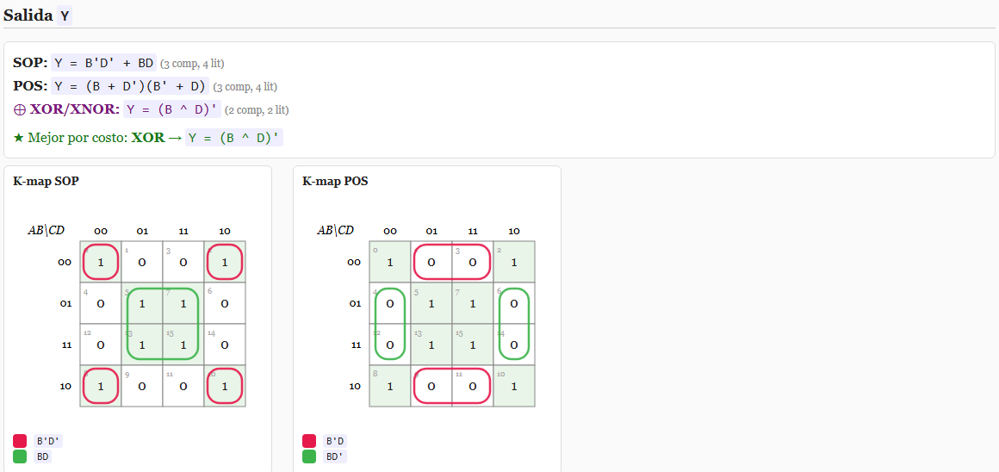
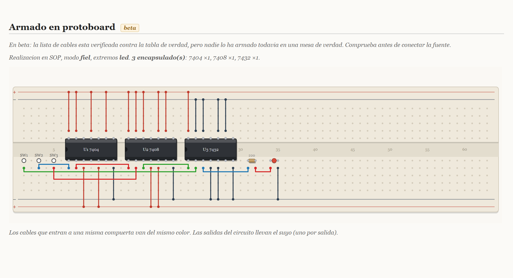
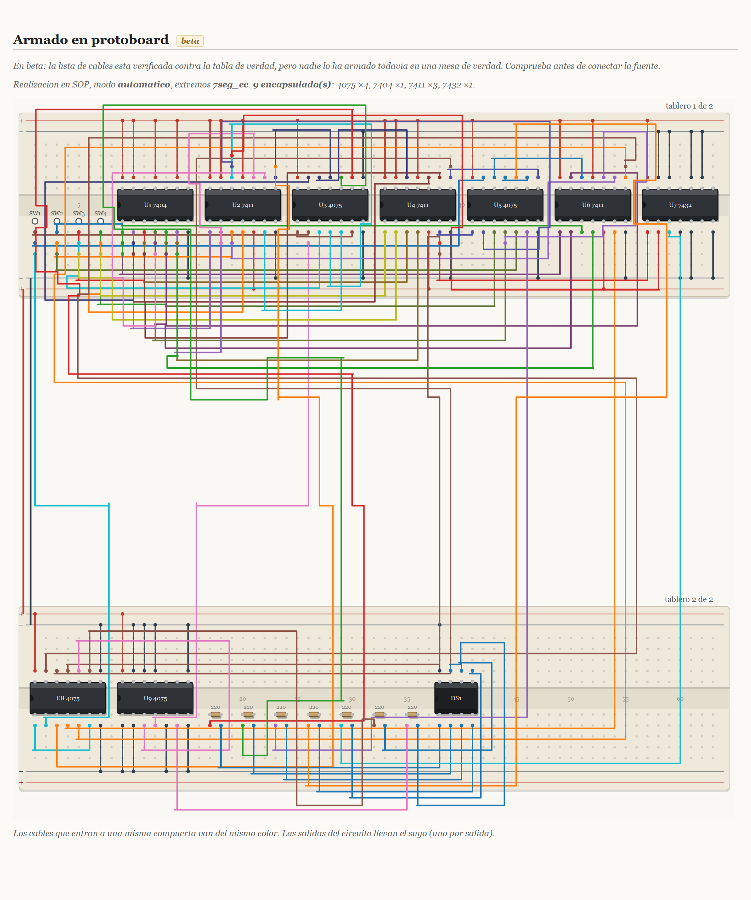

<p align="center">
  <b>English</b> · <a href="LEEME.md">Español</a>
</p>

<div align="center">


# KTool

### Digital logic, minimised exactly — and it tells you when XOR is cheaper.

Fill in a truth table (by hand, from a boolean expression, or from a list of
minterms) and get back the Karnaugh map, the minimal SOP **and** POS equations,
the gate diagram, and an HTML document with all of it.

[](LICENSE)
[](https://www.python.org/)
[](../../actions/workflows/ci.yml)
[](../../releases/latest)


<br>



</div>

---

That picture is a real report, not a mockup — and it shows the thing this tool
does that a K-map by hand doesn't. For that function, SOP costs 3 gates and POS
costs 3 gates, but the function is the parity of B and D, so **`(B ^ D)'` costs
2**. KTool checks that third path every time and tells you when it wins.

## What it is

One tool with **two faces**: a **command-line interface** for when you already
know the minterms and want the answer in the terminal, and a **graphical
interface** that behaves like a spreadsheet for when you're filling a table in by
hand. Both produce the same self-contained HTML document.

It was written for a digital systems course, and it is shaped by that: it handles
several outputs at once, it counts the cost of what it proposes, and it points
out the terms two outputs could share, because that's the part a homework
question actually cares about.

## Purpose and scope

**The purpose.** To be right, and to show its work. Minimising by eye on a
Karnaugh map is where the marks get lost — a group missed, a don't-care wasted,
a POS that would have been cheaper. This does the mechanical part exactly, and
then hands you a document you can read and check.

**What it covers.** Up to **6 variables** and **10 outputs** in one table.
Quine-McCluskey minimisation with don't cares, SOP and POS side by side with
their cost, XOR/XNOR as a third candidate, shared-term detection between outputs,
coloured K-maps, gate diagrams, and export to seven languages.

**What it is not.** A practice project, not a professional design tool. The
arithmetic is exact — truth table plus Quine-McCluskey — but confirm the output
before you build something on it.

## Contents

- [What it is](#what-it-is) · [Purpose and scope](#purpose-and-scope)
- [Install](#install)
- [How to start (CLI)](#how-to-start-cli) · [Expression syntax](#expression-syntax)
- [How to use it (GUI)](#how-to-use-it-gui)
- [What comes out](#what-comes-out) · [Breadboard build](#breadboard-build-beta) *(beta)*
- [Hardware kit](#hardware-kit) — the same circuit for PIC, ESP32, Arduino, FPGA, GAL and 74LS
- [State machines and counters](#state-machines-and-counters) — D, JK, T and SR, VHDL by three methods
- [Known limitations](#known-limitations)
- [For developers](#contributing)

> **The command is `ktool`.** `kmap` is a historical alias — the project started
> out only drawing Karnaugh maps — and still works identically.

## Install

**A — Windows installer (easiest).** Grab the latest from
[Releases](../../releases/latest) and run it; it puts `ktool` on your `PATH`. Or,
in one line of PowerShell:

```powershell
irm https://raw.githubusercontent.com/leostriker111/KTool/main/get-ktool.ps1 | iex
```

**B — pip**, if you already have Python:

```powershell
pip install git+https://github.com/leostriker111/KTool.git
python -m ktool -h      # works always, whether or not ktool landed on the PATH
```

If plain `ktool` then says *"is not recognized"*, pip put it in a folder that
isn't on your `PATH` (it prints a `WARNING` saying so). That happens with the
Microsoft Store Python, and when pip falls back to a per-user install. This
finds the folder and adds it, without touching the rest of your `PATH`; open a
new terminal afterwards:

```powershell
python -m ktool --agregar-al-path
```

**C — from source:**

```powershell
git clone https://github.com/leostriker111/KTool.git
cd KTool
powershell -ExecutionPolicy Bypass -File packaging\install.ps1
```

`-ExecutionPolicy Bypass` is needed because Windows ships with scripts
disabled. It applies to that one run only; your settings stay as they were.

Without installing anything, from the project folder: `python -m ktool ...`

## How to start (CLI)

```powershell
ktool -e "A'B + C" --open                 # build the table from an expression
ktool -n 3 -m 1,4,5,6 -d 2,7              # minterms and don't cares
ktool -n 4 -m 0x1,0b11,5 --text           # mixed bases, equations in the console
ktool -n 3 --truth 01x011x1 --form both   # output vector straight in
ktool ... --gates-only                    # gates only, no K-map and no table
ktool gui                                 # open the window
ktool -h                                  # full help
```

| switch | what it's for |
|---|---|
| `-n, --vars N` | Number of variables (2 to 6). |
| `-e, --expr "..."` | Boolean expression; builds the table by evaluating every case. |
| `-m, --minterms ...` | Minterms in decimal, `0x` hex or `0b` binary. |
| `-d, --dontcares ...` | Don't cares, same syntax. |
| `--truth 01x10...` | Output vector directly (length `2^n`, `x` allowed). |
| `--name Y` | Name of the output. |
| `--form sop\|pos\|auto\|both` | Which form to show. `auto` picks the cheapest. |
| `--no-kmap` / `--no-circuit` / `--no-table` | Leave a section out. |
| `--gates-only` | Gates only (turns off K-map and table). |
| `--text` | Just print the equations to the terminal. |
| `--hw folder` | Write the [hardware kit](#hardware-kit): the circuit as code for every board below. |
| `--pines max2=26,28,33` | With `--hw`: which pins a board uses, inputs first. Repeat it for several boards (`max2`, `uno_nano`, `pic18f45k50`, `esp32_wroom32`, `pico`...). `--max2-pines` is a shortcut for the MAX II. |
| `--kit-en-documento` | Put the hardware kit (pin tables and every file) inside the HTML document. |
| `--out file.html` / `--open` / `--title "..."` | Where the document goes, whether to open it, and its title. |

### Expression syntax

| operation | how you write it |
|---|---|
| AND | `ab`, `a*b`, `a.b`, `a&b` |
| OR | `a+b`, `a\|b` |
| NOT | `a'`, `!a`, `~a` |
| XOR | `a^b` |
| XNOR | `(a^b)'` |

Variables are the letters `A` to `F`. Precedence: NOT, then AND, then XOR, then
OR.

## How to use it (GUI)

```powershell
ktool gui
```

A table in the style of the classic solvers. Along the top you pick the number of
inputs and outputs, turn on the notes column, and choose the form (auto, SOP,
POS, NAND only, NOR only, or both). The expression bar fills a whole column by
evaluating whatever you type.

Everything that comes out of the table lives in the **Resultados** panel at the
bottom, in five tabs that read the same table and the same form:

| tab | what it does |
|---|---|
| *Ecuaciones* | Every form with its cost, and the cheapest. Refreshes itself when you come back to it. |
| *Portada* | Title, author, organisation, course, teacher, group, date, reviewed by and approved by. They become a formal cover page with signature lines; empty fields are left out. |
| *Generar* | A **Contains** list to tick (cover, table, maps, circuits, languages, build, kit) plus what else goes in the folder (the build on its own, the kit folder, the project). One click on *Generar todo* writes it all. |
| *Protoboard* | The physical build: which chips (faithful to the diagram, only the ones you own, or automatic), what goes on the outputs (LEDs, 7- or 16-segment displays), one board per output or one for all. |
| *Kit de hardware* | Writes the [hardware kit](#hardware-kit) folder. If your board has LEDs on fixed pins, pick the board and type its pins; each board remembers its own. |

The *Armado* menu jumps straight to *Protoboard* and *Kit de hardware*.

**Projects and examples.** *Archivo* saves and opens the whole thing (table, names, cover, every tab's options) as a `.ktool.json`. A copy is saved every few seconds, and anything discarded unsaved goes to a recycle bin you can restore from. *Archivo > Ejemplos* has 24 ready circuits: multiplexer, demultiplexer, decoders, priority encoder, BCD and hex to 7 segments, adders, subtractors, comparator, Gray, two's complement, excess-3, and the exercises from the course labs.

**Named inputs.** Click an input header to rename it (`SEL`, `D0`, `EN`): the name reaches equations, maps, document, build and code. Products with long names are written apart (`SEL' D0`), and a name that wouldn't compile in VHDL, Verilog or C is refused on the spot.

Filling a table in fast is the part that was actually designed:

| action | how |
|---|---|
| Select a range | Drag across cells, or <kbd>Shift</kbd>+click to extend. They highlight in blue. |
| Set the whole selection | <kbd>1</kbd>, <kbd>0</kbd> or <kbd>x</kbd> changes every selected cell at once. |
| Cycle one cell | Double-click: `0 → 1 → x`. |
| Copy in and out | <kbd>Ctrl</kbd>+<kbd>C</kbd>/<kbd>V</kbd>/<kbd>X</kbd>, in a format Excel understands. |
| Rename an input or output | Click its column header. |

The *Ayuda* menu has the quick guide, a guide per topic, the shortcut list, the version (*Acerca de*) and a link back here.

## What comes out

One self-contained HTML document. Per output: the SOP and POS equations with
their cost, the recommended form, the Karnaugh map with the groups circled in
colour and named in a legend, the circuit, and the truth table.

With more than one output it adds a section listing the terms that appear in
several — the gates you could physically share — and a combined circuit.

The equations also come out as **Verilog, VHDL, ABEL, Logisim, C, Python and
LaTeX**, each with a copy button.

## Breadboard build <sup>beta</sup>

Newest part, and the reason for the version: KTool now turns the equations into
**a real build on a breadboard** — which chips, where they sit, and every jumper
with its colour.



That is `Y = B'C + A` with a LED at the end, generated by one command. What it
worked out on its own:

- **Which packages.** Three modes: *faithful* to the drawn diagram (even if only
  one AND of the four in a 7408 gets used), *forced* to the chips you actually
  own, or *automatic*, taking the widest gate the circuit needs.
- **The negated literals.** On paper `A'` is a rail; on a breadboard it does not
  exist, so it wires in a 7404 and inverts it.
- **Where the wires go.** Each one leaves from the nearest free socket, not from
  the chip's leg, at right angles and without running on top of another wire.
- **The ends.** Points, LED with its resistor, 7-segment and 16-segment displays,
  common anode and common cathode — with the polarity worked out: on a common
  anode the segment lights **LOW**, so it minimises the zeros instead.
- **More boards** when one is not enough, with the jump drawn between them.

Also: **NAND-only and NOR-only realisations**, which did not exist before. They
matter here because on paper the cost is gates, but on the bench it is packages:
3 ANDs + 1 OR are 4 gates and **2 chips**, the same thing in pure NAND is 4 gates
and **1 chip**.

### See one without installing anything

| Example | What it shows | Open |
|---|---|---|
| **Simple LED** | The one above: `Y = B'C + A`, three packages. | [PDF](ejemplos/led-simple.pdf) · [HTML](ejemplos/led-simple.html) |
| **BCD to 7 segments** | Four inputs, seven outputs sharing terms, common-cathode display, nine packages over two boards. | [PDF](ejemplos/bcd-7segmentos.pdf) · [HTML](ejemplos/bcd-7segmentos.html) |

```
ktool -n 3 -m 1,4,5,6 -d 2,7 --proto --proto-extremos led --out salida.html
```

Every switch is in `ktool --help`: `--proto-modo`, `--proto-chips`,
`--proto-extremos`, `--proto-separado`, `--proto-color-salidas`.

### Why it says beta

Three honest reasons:

1. **Nobody has built one on a real bench yet.** The wire list is verified
   against the truth table — the netlist is evaluated and compared row by row —
   but that is verified *maths*, not a verified *build*.
2. **The GUI has no buttons for it yet.** The CLI has every switch; the graphical
   interface does not expose them.
3. **On big circuits the drawing turns into a spiderweb.** It is measured and
   written down in [issue #8](https://github.com/leostriker111/KTool/issues/8):
   the placement is what degrades — the parts that talk to each other end up far
   apart. The BCD example above is exactly that case, left in on purpose.



## Hardware kit

The minimised circuit, taken off the page and onto the bench: one command writes
a folder with **ready-to-compile code for every common board in a digital
systems lab**, plus the pin wiring for each. Every file is complete. None of
them has an empty function or a `// TODO`, and each one opens with a table of
which signal goes to which physical pin.

```powershell
ktool -e "A'B + C" --hw kit
ktool -n 4 -m 0,1,2,5 --form nand --hw kit_nand    # the form you ask for
```

| platform | what you get |
|---|---|
| **PIC** 18F4550, 18F45K50, 16F877A, 16F628A, 16F84A | A `.c` for MPLAB X + XC8 with the configuration bits, `_XTAL_FREQ`, the analogue pins switched off the way *each* datasheet asks (`ADCON1 = 0x06` on the 877A, not `0x0F`), and `TRIS`/`LAT` set explicitly. |
| **ESP32** WROOM-32, S3, C3 | An Arduino sketch and a MicroPython `main.py`, sharing one pin layout. |
| **Arduino** Uno/Nano, or Mega 2560 | The Uno when it fits; when it doesn't, the Mega, automatically. |
| **STM32** Blue Pill | A sketch for STM32duino. The inputs sit on 5 V-tolerant pins. |
| **Raspberry Pi Pico** | MicroPython with the internal pull-downs on. |
| **VHDL and Verilog** | Synthesisable sources, and a **test bench in each** that sweeps every input combination against the truth table. |
| **MAX II EPM240T100C5** | A Quartus Prime project (`.qpf` + `.qsf`) with user I/O pins only. `--pines max2=...` puts each signal on the pin your board needs, and refuses power, ground and JTAG pins. |
| **GAL22V10** | A WinCUPL `.pld`, with each output placed in a macrocell big enough for its product terms. |
| **74LS chips** | The bill of materials ("1× 74LS00, 2 gates used of 4") and every jumper, pin to pin. |
| **Python** | A standalone script that prints the truth table of the equations and checks it against yours. |

**When a board can't take the circuit, it says so instead of writing broken
code.** The kit's `LEEME.md` gives the exact count:

```text
-- ESP32-C3 (DevKitM-1 / SuperMini)
   Variante bloqueada: requiere 6 entradas + 10 salidas = 16 pines y ESP32-C3
   (DevKitM-1 / SuperMini) solo tiene 13 utilizables (8 seguros + 5 de reserva)
-- PIC16F84A
   Variante bloqueada: el programa necesitaria unas 1325 palabras (128 terminos)
   y el PIC16F84A tiene 1024; usa uno con mas memoria
```

**Pins that interfere with something else are kept back.** That covers the
ESP32's flash and strapping pins, the PICkit's PGC/PGD, USB lines and RA4's open
drain. They are only used when nothing else is left, and the pin table then
carries a warning next to them.

**How it was checked.** Every file was put through the real tool for its platform, on 21 generated circuits (2 to 6 inputs, 1 to 24 outputs, every form, the worst cases for memory included): **88 PIC files** compiled with XC8 v3.10 with no errors or warnings; **21 Arduino sketches** (Uno or Mega) compiled with `arduino-cli`, and **31 ESP32 (WROOM-32, S3, C3) and Blue Pill sketches** from a sample of 8 circuits; **42 test benches** run in GHDL (VHDL) and Icarus Verilog, every combination matching the truth table; and the 21 Python simulations. On top of that the test suite checks the logic of each output (the C equation, the PIC's bit masks, the MicroPython file run against a fake `machine` module) row by row on about 150 random tables. Details in [docs/HARDWARE.md](docs/HARDWARE.md).

**In the window too.** The *Kit de hardware* tab writes the kit for the table on
screen. That is the way to get **several outputs**, which the command line can't
take. Fixed pins work for **any board** in the list, not just the MAX II, and the
*Documento* tab can put the whole kit (pin tables and every file) inside the HTML.
From the command line: `--pines max2=26,28,33 --pines uno_nano=2,3,8` and
`--kit-en-documento`.

The hardware kit covers **combinational** circuits. State machines have their
own section, below.

## State machines and counters

Synchronous Moore and Mealy machines, from a table of states and transitions,
and **counters** described the way the lab exercises word them:

```powershell
ktool contador --mod 13 --baja
ktool contador --secuencia 4,7,2,6,0,3,5,1 --entradas X --modo 0=sigue --modo 1=paro
ktool contador --entradas X,Y --modo 00=0-15 --modo 01=paro --modo 10=reinicio --modo 11=15,12,9,6,3,0 --ff JK --vhdl vhdl_mod16
ktool fsm maquina.json --ff T
```

Each mode is a list (`4,7,2`), a range (`0-15` up, `12-0` down), `paro` (hold),
`reinicio` (back to the first number) or `set` (every flip-flop to 1). If a mode
starts from a number that isn't in its list, it jumps to that list's first number.

The document walks the whole design: state diagram, state assignment, state
table, the transition and **excitation table for D, JK, T or SR**, each
flip-flop input minimised with its K-map, the circuit with the flip-flop bank,
and the **VHDL by the three methods** of the lab: *equations* (the flip-flop
equations under a `rising_edge` process), *table* (a `case` over state and
inputs) and *state diagram* (an enumerated state type). The three share one
entity, so one generated test bench checks any of them, cycle by cycle.

In the window, the *Secuencial* menu opens the state-machine editor (states and
transitions as tables, with a live graph) and a *Contador…* dialog. *Archivo >
Ejemplos > Contadores* has the counters from the lab already set up.

**How it was checked.** The 8 counters from the lab plus 2 more machines, each
in the 3 methods and with the 4 flip-flop types: **60 GHDL simulations** in
strict VHDL-93, every mode and random mode switches, all matching the Python
simulation; the three methods also go through GHDL synthesis. The test suite
checks that each flip-flop's minimised equations, applied through its
characteristic equation, reach the right next state on every transition.

## Known limitations

Worth stating plainly, since the whole point is being trustworthy:

- **XOR/XNOR detection** applies when the complete function is the parity of a
  subset of the variables. It does not factor partial XORs out of a large SOP.
- **The circuit assumes complemented literals are available** (`A'` rails), and
  it does not draw a single schematic with the shared gates merged in — those are
  listed separately.
- **No symbolic boolean algebra** over arbitrary expressions.
- **The breadboard build is beta**: verified against the truth table, but
  not yet built on a real bench, without GUI buttons, and tangled on big
  circuits ([#8](https://github.com/leostriker111/KTool/issues/8)).
- **The hardware kit is combinational only** (state machines get VHDL only, for now), and its code has been compiled
  and simulated but not yet flashed onto the boards. The GAL file follows
  WinCUPL's syntax but has not been through WinCUPL itself, and the Quartus
  project has not been through Quartus: neither is installed where this was
  built.

<br>

---

<div align="center">

## 🔧 For developers

*Everything above is what it does. Everything below is how it does it.*

</div>

---

### Contributing

The `main` branch is protected, so changes come in by Pull Request. See
[CONTRIBUTING.md](CONTRIBUTING.md).

Where help would go furthest:

- **Partial XOR factoring** — the biggest real limitation above, and the one that
  would most change the quality of the answers.
- **A single combined schematic** with the shared gates actually drawn in, rather
  than listed.
- **More target languages** in `codegen.py` — SystemVerilog and VHDL-2008 are the
  obvious gaps.
- **Verification against a known-good minimiser** (Espresso) over random
  functions, as a test.
- **More boards for the hardware kit.** A board is pure data in
  `hw/placas.py`: its pins in order of preference, plus the ones to avoid and
  why. Flashing a generated file onto real hardware and reporting back is just
  as welcome.

The design notes are in [docs/DESIGN.md](docs/DESIGN.md).

### What it's made of

**Python 3.8+ with no external dependencies at all** — standard library only,
Tkinter for the window. That is a deliberate constraint: this gets run on lab
computers where you cannot install anything, and `pip install` would already be
one obstacle too many. It's also why the output is a single HTML file rather than
a rendered PDF.

### The modules

About 2,400 lines, split by job.

<details open>
<summary><b>core — the maths</b></summary>

<br>

| module | lines | what it does |
|---|--:|---|
| `core/lexer.py` | 44 | Turns an expression into tokens. |
| `core/parser.py` | 75 | Tokens into a syntax tree, with the precedence above. |
| `core/ast.py` | 52 | The tree nodes, and evaluating one for a given input. |
| `core/table.py` | 74 | The truth table: minterms, don't cares, several outputs. |
| `core/qm.py` | 108 | **Quine-McCluskey.** Prime implicants and the cover — the exact part. |
| `core/simplify.py` | 151 | Runs the three candidates (SOP, POS, XOR), costs them in gates and literals, and picks. |
| `core/kmap_layout.py` | 46 | Gray-code ordering, so that adjacent cells really are adjacent. |

</details>

<details>
<summary><b>render — the document</b></summary>

<br>

| module | lines | what it does |
|---|--:|---|
| `render/report.py` | 318 | Assembles the HTML: everything inline, no external files. |
| `render/circuit.py` | 374 | Draws the gates. The largest single file, because laying out a schematic is genuinely harder than minimising it. |
| `render/codegen.py` | 170 | The seven output languages. |
| `render/kmap.py` | 112 | The map, with each group circled in its own colour. |

</details>

<details>
<summary><b>gui and cli</b></summary>

<br>

| module | lines | what it does |
|---|--:|---|
| `gui/app.py` | 680 | The window and the spreadsheet-like table. |
| `gui/displays.py` | 89 | Showing the results in the lower panel. |
| `cli.py` | 134 | Argument parsing and the pipeline. |
| `theme.py` | 23 | Colours shared between the window and the report. |

</details>

<details>
<summary><b>hw — the hardware kit</b></summary>

<br>

| module | lines | what it does |
|---|--:|---|
| `hw/placas.py` | 281 | Every board as data: usable pins in order, the ones held back and why, DIP pin numbers, memory. The MAX II pins come from Intel's official pin-out table. |
| `hw/modelo.py` | 250 | The solved circuit, the equation written with *every* parenthesis (C, Python, VHDL and Verilog all order operators differently), and the pin allocator that blocks with an exact count. |
| `hw/micros.py` | 413 | PIC, ESP32, Arduino, Blue Pill and Pico. On the PIC each term becomes a bit-mask comparison, so the circuit fits in a 16F84A's 1K words. |
| `hw/logica.py` | 502 | VHDL, Verilog, both test benches, the Quartus files, the GAL22V10, the 74LS bill of materials (reusing the breadboard netlist) and the Python simulation. |
| `hw/kit.py` | 197 | Writes the folder and the summary of what was generated and what was blocked. |

</details>

### The decision behind the interesting part

Most K-map tools give you SOP. Some give you SOP and POS. The reason this one
computes a **third** candidate is that for a whole family of common functions —
parity, comparators, adders — both of the first two are wrong answers to the
question "what is cheapest". A 4-variable parity function is four AND gates and
an OR in SOP, and a single XNOR in reality.

So `simplify.py` doesn't minimise, it **competes**: it builds all three, prices
each in gates and literals, and reports the winner along with the two losers so
you can see the margin. That is also why the cost is printed next to every
equation rather than only next to the chosen one.

### License

[MIT](LICENSE).

### Related projects

- **[Logisim Evolution](https://github.com/logisim-evolution/logisim-evolution)** —
  *use that to simulate the circuit;* KTool exports straight to its format.
- **[Espresso](https://en.wikipedia.org/wiki/Espresso_heuristic_logic_minimizer)** —
  *reach for that beyond 6 variables,* where exact minimisation stops being
  practical and heuristics take over.
